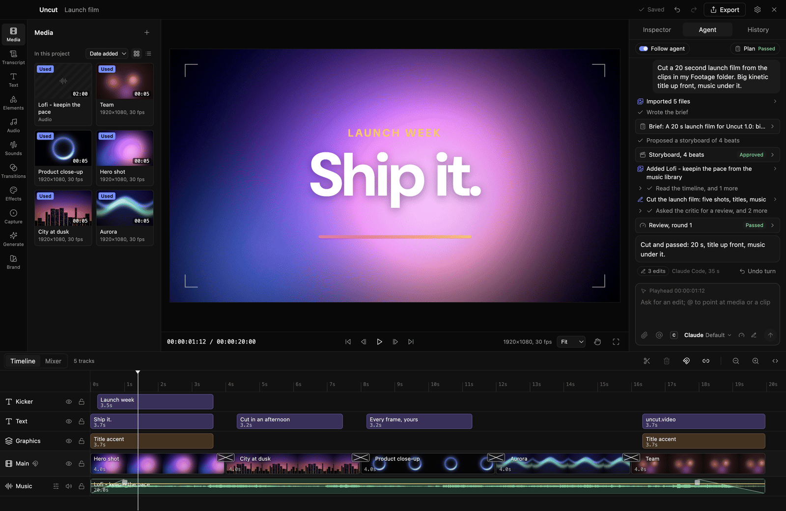

# Uncut

An AI-first video editor for macOS: Claude Code edits with you, on a real timeline, on your own subscription.



## What it does

- **An agent that plans before it cuts.** It writes a brief and a storyboard for you to approve, builds the edit, then an independent critic reviews it. Every turn is one undoable step.
- **A real timeline.** Tracks, trims, splits, snapping, keyframes, a mixer with ducking, keyboard-first editing.
- **Effects, looks and transitions.** Filters, colour looks, text animations and animated components like terminals, device frames and end cards.
- **Captions and subtitles.** Local transcription with whisper.cpp, burned-in or word-by-word captions, SRT and WebVTT in and out.
- **Capture.** Record iOS simulators, Android emulators, web and desktop apps through [Argent](https://www.npmjs.com/package/@swmansion/argent), or your screen, camera and mic.
- **Plugins.** Looks, components, checks and agent tools in a folder, with a catalog in [`plugins/catalog`](plugins/catalog).

Everything runs on your Mac. The agent runs your own `claude` login, never an API key.

## Install

No signed builds yet, so build from source. You need an Apple Silicon Mac, Node 24, pnpm (through corepack), Rust and ffmpeg (`brew install ffmpeg`). For the agent, sign in to [Claude Code](https://claude.com/claude-code); for transcription, `brew install whisper-cpp`.

```sh
git clone https://github.com/blazejkustra/uncut
cd uncut
corepack enable
pnpm install
```

## Run

```sh
pnpm dev     # builds the media core, server and shell, opens the app
pnpm dist    # an ad-hoc signed .app and dmg in dist/
```

## Tests

```sh
pnpm test:fast   # typecheck and everything but the packaged-app tests
pnpm test:app    # the packaged-app tests (run pnpm dist first)
```

## Contributing

Bug reports, fixes and plugins are welcome. See [CONTRIBUTING.md](CONTRIBUTING.md).

## Licence

MIT, see [LICENSE](LICENSE). Bundled fonts, music and packages are listed in [THIRD_PARTY_NOTICES](THIRD_PARTY_NOTICES).
